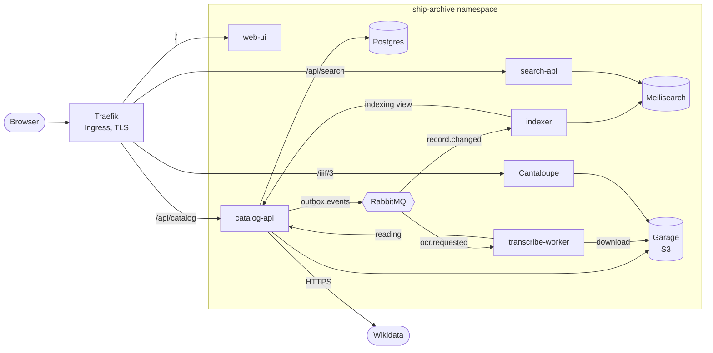
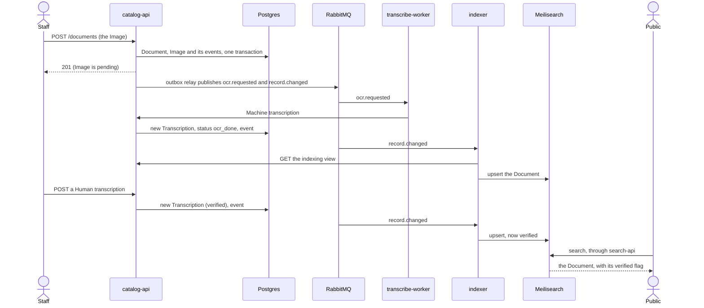

# Architecture

Ship Archive Lite is a microservice archive for scanned ship documents. Staff upload an Image of a Document, a machine reads its text, a person corrects it, and the public searches everything (including by the names a ship carried in the past) and zooms deep into the Image. The vocabulary used here (Document, Image, Transcription, Verified, Subject, Ship, Name, Relation, and so on) is defined in the [glossary](../GLOSSARY.md). This document explains what runs, why, and how the parts fit; [security.md](security.md) and [discussion.md](discussion.md) cover the rest of the written deliverables, and [demo.md](demo.md) shows it working. The [README](../README.md) is how to run it.

The assignment asks for a microservice application on Kubernetes with at least two self-created services that expose REST APIs and scale independently, a database that survives restarts, images on Docker Hub and an external REST API consumed programmatically. **Five services are built here, and the assignment is met by those alone.** The third-party services were approved on that condition and each one earns its place below.

## Components

Everything runs in one Kubernetes namespace, `ship-archive`, on Docker Desktop. The five self-created services are published as `kiwijos/ship-archive-<service>:<version>` on Docker Hub, one version per slice, and the manifests pin those exact tags.

| Component | Self-created or third-party | What it does | Why it exists / what it scales on |
|---|---|---|---|
| catalog-api | self-created | The write side. REST API for Documents, Images, Transcriptions, Ships, Organisations, Names, Relations and Wikidata matches; stores uploads in Garage; writes every change and an event for it to Postgres in one transaction; relays the events to RabbitMQ | Stateless, so replicas share the work; scales 2 to 4 on CPU |
| search-api | self-created | The read side. Public REST API for search, suggestions, facets and the landing data of Documents and Subjects, answered only from the search index | Holds a search-only key and has no route to Postgres; scales 2 to 4 on CPU |
| indexer | self-created | Consumes change events, fetches the indexing view of the changed Document or Subject from catalog-api and writes it to the search index; can rebuild the whole index on request | Three replicas, one working and two on standby ([ADR 0009](adr/0009-the-indexer-runs-as-hot-standbys.md)) |
| transcribe-worker | self-created | Consumes OCR jobs, reads the Image with Tesseract (Swedish and English) and posts the Machine transcription to catalog-api | The competing consumer: scales 1 to 4 on CPU, each replica takes one job at a time |
| web-ui | self-created | The browser interface: public search and landing pages, the deep-zoom viewer, the staff review screens. Plain JavaScript with OpenSeadragon, served by nginx; talks to the APIs only through relative paths | Three fixed replicas; nearly idle |
| Postgres | third-party | The source of truth (version 16): the catalog, the append-only Transcriptions and the outbox of events | Needed for transactions: an event must commit with the change it describes, and Transcriptions must never be overwritten ([ADR 0001](adr/0001-append-only-transcriptions-with-source.md), [ADR 0003](adr/0003-transactional-outbox.md)). StatefulSet on a volume; single instance |
| RabbitMQ | third-party | The message broker, with two durable queues (`ocr.requested`, `record.changed`) and a dead-letter queue for each | Separates slow work (OCR, indexing) from the request that caused it, gives competing consumers for free, and keeps messages through a restart. StatefulSet on a volume; single instance |
| Meilisearch | third-party | The search index: typo-tolerant text search over every name and every Transcription, highlighting, synonyms and facets | Search with misspellings, old names and facets is what the public needs, and Meilisearch does it with little configuration and a small memory footprint. Elasticsearch or OpenSearch would do it too but would crowd a 16 GB laptop. Derived data, rebuilt by `make reindex` ([ADR 0005](adr/0005-derived-search-index-and-per-service-keys.md)). Single instance |
| Garage | third-party | S3-compatible object storage for the uploaded Images (the `masters` bucket; a `derivatives` bucket is created and reserved) | Images are tens of megabytes and do not belong in a database. Garage speaks the S3 protocol, so any S3 store can replace it, and it is small enough for one node. Single instance, one volume |
| Cantaloupe | third-party (version 5.0.7; the image is built here from the upstream release) | The IIIF image server: cuts a very large Image into the tiles a viewer asks for, so a 60-megapixel plate opens at once and zooms smoothly | Producing deep-zoom tiles is a specialised job with a standard protocol (IIIF); writing it would be a project of its own. Reads the originals from Garage with a read-only key ([ADR 0006](adr/0006-cantaloupe-serves-originals-by-image-id.md)). Scales 1 to 3 on CPU; each replica can hold over a gigabyte |
| Traefik | third-party (cluster tooling) | The Ingress controller: terminates TLS, routes by path and rate-limits tile requests | A Kubernetes cluster needs one to be reachable from outside; ingress-nginx is retired. Installed once by `make cluster-tools` |
| metrics-server | third-party (cluster tooling) | Reports each pod's CPU to the autoscalers | The HorizontalPodAutoscalers cannot work without it. Installed by `make cluster-tools` |

Three one-shot Jobs run on every deploy and are safe to repeat: `catalog-api-migrate` (database migrations), `garage-init` (buckets, one access key per service) and `meilisearch-init` (the per-service search keys). Two things are used but are not components: **Tesseract**, the OCR library inside transcribe-worker, and **Wikidata**, the external REST API that catalog-api consumes (below).

## Logical components and the services that implement them

The system is easier to understand as a set of responsibilities than as a set of processes, and each responsibility has one home.

| Logical component | Implemented by | Notes |
|---|---|---|
| Catalog (Documents, Images, Subjects, Names, Relations) | catalog-api on Postgres | The only writer of the catalog |
| Upload and storage of Images | catalog-api, Garage | Type checked by magic bytes, SHA-256 recorded, duplicates flagged |
| Transcription | transcribe-worker, with catalog-api as the owner of the result | A Machine transcription is a new row; a person's correction is another ([ADR 0001](adr/0001-append-only-transcriptions-with-source.md)) |
| Review workflow | catalog-api (queue, status) and web-ui (the screens) | Staff sign in with a named token |
| Event relay | catalog-api (the outbox) and RabbitMQ | [ADR 0003](adr/0003-transactional-outbox.md) |
| Search indexing | indexer and Meilisearch | A derived view; never the source of truth |
| Public search and landing pages | search-api and web-ui | Every Ship and Document has a permanent address |
| Image delivery and the viewer | Cantaloupe, Garage and web-ui | IIIF Image API 3 |
| Authority enrichment | catalog-api and Wikidata | A person chooses the match ([ADR 0007](adr/0007-wikidata-matches-are-chosen-by-a-person-and-fetched-by-the-server.md)) |
| Gateway | Traefik | One address, four prefixes |
| Dated names and relations | catalog-api | A ship's life, not just its current name ([ADR 0004](adr/0004-subjects-with-dated-names-and-relations.md)) |

## Diagrams

**What runs and who talks to whom.** An arrow is a network path that a NetworkPolicy allows; any other connection is dropped ([security.md](security.md)).

**From upload to search.** The browser gets an answer as soon as the Document is stored; reading and indexing happen afterwards, and a correction becomes searchable seconds later.

## Patterns

| Pattern | Where it is used | Why |
|---|---|---|
| **Microservices** | Five independently built, versioned, deployed and scaled services, each with one responsibility | A slow OCR or a busy search must not slow uploads, and each part can fail, restart and scale on its own |
| **CQRS** (separate write and read models) | catalog-api writes to Postgres; search-api reads only from the search index, which the indexer builds from the catalog | The questions asked of the public search (typos, old names, facets) are shaped nothing like the transactions staff make, so each side has the store that suits it. search-api has no database credentials and no route to Postgres at all |
| **Event-driven eventual consistency** | A change commits to Postgres with an event in the same transaction (the **transactional outbox**); every catalog-api replica relays events to RabbitMQ; consumers are idempotent because delivery is at least once | The index follows the catalog by seconds, never loses a change and never publishes one that did not commit ([ADR 0003](adr/0003-transactional-outbox.md)). `make reindex` can rebuild it from nothing ([ADR 0005](adr/0005-derived-search-index-and-per-service-keys.md)) |
| **Competing consumers** | Every transcribe-worker replica takes OCR jobs from the one `ocr.requested` queue, one at a time, and acknowledges only after catalog-api accepted the result | Throughput grows by adding replicas, and a worker that dies loses nothing: its job is delivered to another. `make ocr-parallel` shows ten Images read by three workers |
| **Hot standby** (single active consumer) | Three indexers consume `record.changed`; the broker lets one work and hands over to the next when it stops | Changes are applied in order, and a rollout or a crash is invisible ([ADR 0009](adr/0009-the-indexer-runs-as-hot-standbys.md)) |
| **Stateless services with externalised state** | Every service keeps its state in Postgres, Garage, RabbitMQ or Meilisearch and only temporary files locally; configuration comes from the environment | Any replica can be stopped, replaced or added at any moment, which is what makes rolling updates and autoscaling safe |
| **API gateway via Ingress** | Traefik is the only way in: `/` to web-ui, `/api/catalog`, `/api/search` and `/iiif/3` to their services; it terminates TLS and rate-limits tile requests. Postgres, RabbitMQ, Meilisearch and Garage are never routed | One address, one place for TLS and limits, and nothing else reachable from outside |
| **Dead-letter queues, retries and bounded effort** | A message that keeps failing is moved aside after a few tries and the Image is marked failed, instead of blocking the queue; calls to Wikidata have timeouts, retries and a total budget | A bad Image or a slow outside service cannot stop the system |
| **Presigned download address** | catalog-api signs a short-lived address that the worker uses to fetch an Image straight from Garage | Large Images do not pass through the API |

## Data model in brief

A **Document** has one or more **Images**; an Image has any number of **Transcriptions**, each a new row with its source, so nothing is ever overwritten and the **Current text** is the latest human one, otherwise the latest machine one. **Verified** is derived from those rows, and a Document is verified only when every Image is. A **Subject** is a Ship or an Organisation; it has dated **Names**, so a ship is found by any name it carried, and dated **Relations** (built by, owned by, operated by, rebuilt from) that describe its life ([ADR 0004](adr/0004-subjects-with-dated-names-and-relations.md)). Dates are kept as written together with the earliest and latest they could mean. Every table has timestamps and a soft delete, and Documents, Ships and Organisations may carry a source key saying where they came from ([ADR 0008](adr/0008-the-demo-is-seeded-through-the-public-api-with-source-keys.md)). No person or crew record exists, by decision ([ADR 0002](adr/0002-no-person-or-crew-data.md)).

## Interfaces

| Interface | Address (through the Ingress) | Notes |
|---|---|---|
| catalog-api REST | `/api/catalog`, documentation at `/api/catalog/docs` | Staff endpoints need a named bearer token; a service token reaches only what the worker and indexer need |
| search-api REST | `/api/search`, documentation at `/api/search/docs` | Public, read-only, rate-limited per address |
| IIIF Image API 3 | `/iiif/3/{image id}/info.json` and tiles | Public; the identifier is the Image's id |
| indexer | `POST /reindex`, `GET /reindex` | Inside the cluster only, with a token; run through `make reindex` |
| Message contracts | `contracts/` | JSON Schema for `ocr.requested`, `record.changed` and the indexing view, validated by publisher and consumer |
| Wikidata (consumed) | `wikidata.org` search and entity APIs | Called only by catalog-api, in two steps: list candidates, then store the one a person chose ([ADR 0007](adr/0007-wikidata-matches-are-chosen-by-a-person-and-fetched-by-the-server.md)) |

## How it is deployed

Plain manifests in `k8s/`, applied with Kustomize and no Helm for the application. `make deploy` creates the Secrets, runs the Jobs, applies everything and waits until every workload is ready. Postgres, Garage, Meilisearch and RabbitMQ each keep their data on a volume; the four autoscaled services have HorizontalPodAutoscalers; every workload has requests, a memory limit and probes. [The README](../README.md#scaling-and-persistence) has the measured numbers and [security.md](security.md) the network and credential design.
